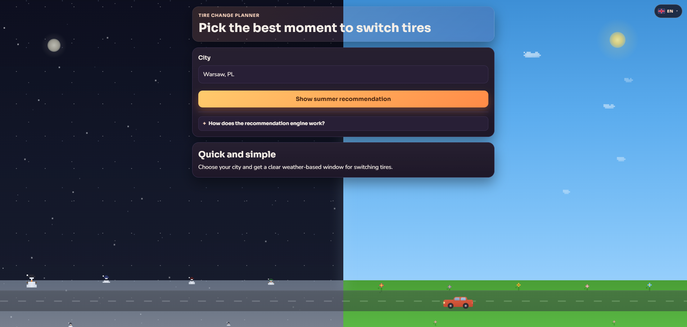
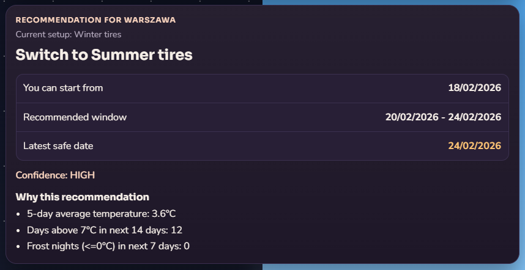
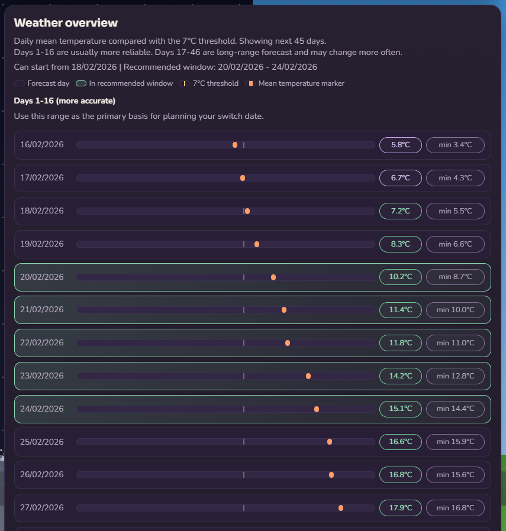

# 🚗 When To Change Car Tires

## 📋 Overview

Simple weather-based app that helps decide when to switch between summer and winter tires.

You choose a city (or use auto-detection), then the app calculates a clear recommendation window based on temperature trend and frost risk.

## 🌐 Live Preview

Visit the live website at: **[when-to-change-car-tires.vercel.app](https://when-to-change-car-tires.vercel.app/)**


## 🖼️ Preview







## ✨ Features

- Auto-detects city from IP (with manual search fallback)
- City autocomplete for locations worldwide
- Clear tire switch milestones:
  - can start planning
  - recommended window
  - latest safe date
- Recommendation confidence based on weather history, forecast and frost risk
- Weather breakdown for near-term and long-range data
- English and Polish language support

## 🧰 Requirements

- Node.js 20+
- npm

## 📦 Installation

```bash
npm install
```

## ▶️ Run Locally

```bash
npm run dev
```

Open `http://localhost:3000` in your browser.

## ⚙️ Available Scripts

```bash
npm run dev    # run development server
npm run build  # build for production
npm run start  # start production build
npm run lint   # run ESLint
npm run test   # run Vitest tests
```

## 🛠️ Tech Stack

- Next.js
- React
- TypeScript
- Vitest
- Open-Meteo APIs
